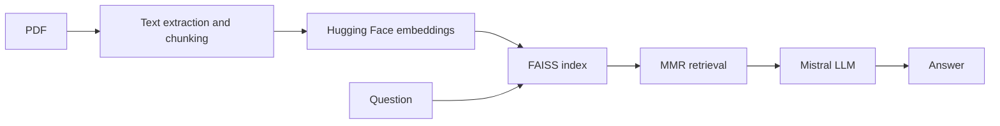

# RAG Book Assistant

A Streamlit application for asking questions about uploaded PDFs using retrieval-augmented generation.

## Architecture



The Streamlit entry point uses FAISS, 1,000-character chunks with 200-character overlap and MMR retrieval of three chunks.

## Setup

```bash
git clone https://github.com/dheerajbhukya7/RAG-BOOK-ASSISTANT.git
cd RAG-BOOK-ASSISTANT
python -m venv .venv
# Activate the environment
pip install -r requirements.txt
```

Set `HF_TOKEN` and `MISTRAL_API_KEY` in a local `.env` file. Verify provider model availability.

```bash
streamlit run app.py
```

Upload a text-based PDF and ask a question. Document text and retrieved passages are transmitted to external AI providers; do not upload confidential documents without authorization.

## Limitations and evaluation

Answers may be inaccurate; the current UI does not provide explicit page citations. Scanned PDFs may require OCR. Evaluate answer correctness, retrieval recall, unsupported-question abstention and latency with a labeled question set. No benchmark results are claimed yet.

## Repository overview

PDF question answering with LangChain, FAISS, Hugging Face embeddings and Mistral.

**Suggested GitHub topics:** `rag` `retrieval-augmented-generation` `langchain` `faiss` `huggingface` `mistral-ai` `streamlit`.
